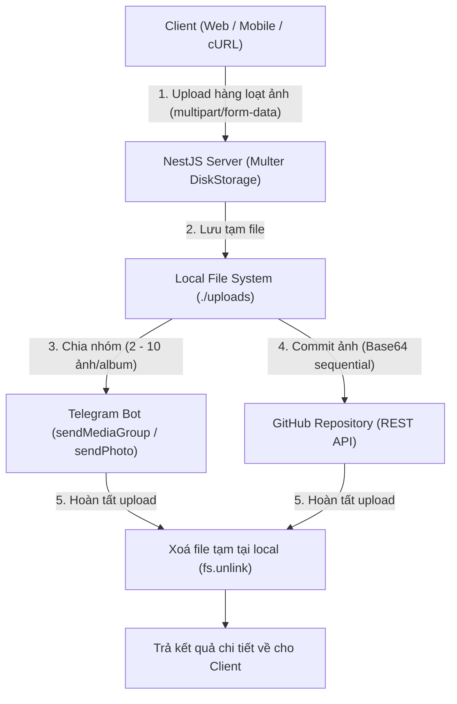

# Manage Image Backend (Telegram & GitHub Sync)

Hệ thống server chuyên nhận upload lượng lớn ảnh từ client, lưu tạm ở local file system, sau đó gửi theo kiểu album lên Telegram bot và lưu file vào GitHub repository (không dùng database). Khi file đã được tải lên cả 2 nơi thành công, server sẽ tự động xoá file ở local để giải phóng dung lượng đĩa.

---

## 🚀 Luồng hoạt động (Workflow)



1. **Client Upload**: Client gửi nhiều file ảnh (lên đến 200 file/request, 50MB/file) qua `POST /upload`.
2. **Server lưu tạm**: Multer lưu file trực tiếp vào thư mục `./uploads` với tên file duy nhất (`{timestamp}_{uuid}_{name}`).
3. **Telegram Album**:
   - Chia danh sách file thành từng nhóm 2-10 ảnh và gọi Telegram Bot API `sendMediaGroup`.
   - Nếu chỉ có 1 ảnh, gọi `sendPhoto`.
   - Tự động delay giữa các batch để tránh dính giới hạn tốc độ (Rate Limit) của Telegram.
4. **GitHub Repository**:
   - Mã hoá Base64 và commit từng file lên GitHub Repo thông qua GitHub REST API `PUT /repos/{owner}/{repo}/contents/{path}`.
   - Cơ chế tự động thử lại (Retry with backoff) nếu gặp conflict (409) hoặc race condition.
5. **Xoá file tại server**:
   - Ngay sau khi file được gửi thành công lên Telegram và GitHub, server gọi `fs.promises.unlink` để xoá file tạm tại `./uploads`.
   - Báo cáo chi tiết số lượng file thành công/thất bại và số file đã xoá.

---

## ⚙️ Cấu hình biến môi trường (`.env`)

Tạo file `.env` ở thư mục gốc dựa theo `.env.example`:

```env
PORT=3000

# Telegram Bot Configuration
TELEGRAM_BOT_TOKEN=123456789:ABCDefGhIJKlmNoPQRsTUVwxyZ
TELEGRAM_CHAT_ID=-1001234567890

# GitHub Configuration
GITHUB_TOKEN=ghp_YourPersonalAccessTokenHere
GITHUB_OWNER=your-username-or-org
GITHUB_REPO=your-image-repo
GITHUB_BRANCH=main
GITHUB_TARGET_PATH=images
```

### Hướng dẫn lấy Token:

- **Telegram Bot**:
  1. Chat với [@BotFather](https://tme/botfather) trên Telegram để tạo bot và lấy `TELEGRAM_BOT_TOKEN`.
  2. Tạo nhóm/kênh, thêm bot vào làm Admin (hoặc chat riêng với bot), lấy `TELEGRAM_CHAT_ID` (có thể dùng bot [@userinfobot](https://t.me/userinfobot) hoặc xem qua `https://api.telegram.org/bot<TOKEN>/getUpdates`).
- **GitHub Token**:
  1. Vào GitHub: `Settings` ➔ `Developer settings` ➔ `Personal access tokens` (Tokens classic hoặc Fine-grained).
  2. Chọn quyền `repo` (Contents: Read and Write).

---

## 🛠️ Cài đặt & Khởi chạy

```bash
# Cài đặt dependencies (nếu chưa cài)
npm install

# Chạy ở chế độ phát triển (auto-reload)
npm run start:dev

# Chạy ở chế độ production
npm run build
npm run start:prod
```

Server sẽ chạy mặc định tại: `http://localhost:3000`

---

## 📡 API Reference

### 1. Upload ảnh hàng loạt

- **Endpoint**: `POST /upload` hoặc `POST /upload/images`
- **Content-Type**: `multipart/form-data`
- **Fields**:
  - `files` hoặc `images` (File array): Danh sách các file ảnh cần upload.
  - `caption` (text, tuỳ chọn): Tiêu đề mô tả cho album Telegram.
  - `folder` (text, tuỳ chọn): Thư mục lưu trữ trên GitHub (mặc định: `uploads` hoặc giá trị trong `GITHUB_TARGET_PATH`).

#### Ví dụ cURL:

```bash
curl -X POST http://localhost:3000/upload \
  -F "files=@photo1.jpg" \
  -F "files=@photo2.png" \
  -F "files=@photo3.jpg" \
  -F "caption=Bộ sưu tập dã ngoại 2026" \
  -F "folder=events/picnic"
```

#### Phản hồi chấp nhận mẫu:

```json
{
  "success": true,
  "async": true,
  "sessionId": "sess_...",
  "batchReceived": 3,
  "totalQueued": 3,
  "status": "queued",
  "message": "Đã lưu 3 ảnh trên server. Đang tải ngầm lên Telegram và GitHub; bạn có thể đóng tab."
}
```

### Upload nền (đóng tab vẫn tiếp tục)

Tất cả endpoint multipart (`POST /upload`, `/upload/images`, `/upload/batch`, `/api/images` và `/api/images/batch`) đều trả HTTP `202 Accepted` ngay sau khi file đã được ghi xuống filesystem và manifest được lưu; không đợi Telegram hay GitHub. Có thể gửi một `sessionId` cố định ở query, header `x-session-id` hoặc field form để các lô được gom vào cùng một phiên. Nếu không truyền, server tự tạo session mới.

Sau phản hồi, client có thể đóng tab; worker xử lý lần lượt từng lô lên Telegram và GitHub. Dùng `GET /api/images/session/{sessionId}` hoặc `GET /upload/session/{sessionId}` để xem tổng tiến độ, trạng thái từng ảnh và lỗi nếu có. Khi Telegram/GitHub lỗi, server thử lại tối đa 3 lần với khoảng chờ ngẫu nhiên giữa các lần thử. Khi tất cả lần thử đã kết thúc, server xóa các file staging dù kết quả thành công hay thất bại; manifest nhỏ vẫn được giữ để xem kết quả session.

```bash
curl -X POST "http://localhost:3000/upload/batch?sessionId=album-2026" \
  -F "files=@photo1.jpg" \
  -F "files=@photo2.png" \
  -F "album=album-2026"

curl "http://localhost:3000/upload/session/album-2026"
```

Để worker tiếp tục sau khi process restart, cần chạy một instance server trên ổ đĩa có thể ghi và lưu bền vững thư mục `uploads/` (không dùng filesystem tạm thời của container). Request bị ngắt trước khi gửi xong không thể đảm bảo file chưa truyền đủ được lưu.

---

### 2. Kiểm tra trạng thái cấu hình

- **Endpoint**: `GET /upload/status`
- **Trả về**: Kiểm tra xem Bot Telegram và GitHub Token đã được cấu hình hợp lệ chưa.

---

### 3. Giao diện Web Test (Drag & Drop UI)

- **Truy cập**: `http://localhost:3000/upload/ui` hoặc `http://localhost:3000/`
- Cho phép kéo thả trực tiếp hàng trăm ảnh trên trình duyệt, nhập caption và ấn upload để xem kết quả trực quan ngay lập tức.
